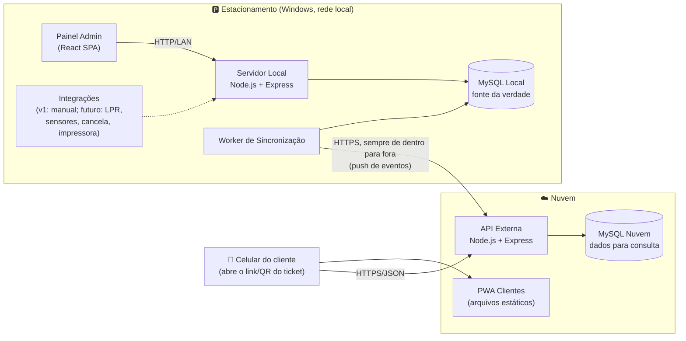

# Arquitetura Técnica — Sistema de Estacionamento

> Status: **v0.3: requisitos, tarifas, retenção e domínio definidos**. Nenhum código foi implementado ainda.
> Itens marcados com ⚠️ ainda precisam de definição.

---

## 0. Escopo da versão 1 (confirmado)

| Tema | Na v1 | Deixar preparado para o futuro |
|------|-------|--------------------------------|
| Estabelecimentos | 1 estacionamento | Vários (`site_id` em todas as tabelas desde já) |
| Acesso do cliente | **Sem conta**: link individual ou QR Code com token seguro | Solicitação de cadastro de mensalista |
| Entrega do QR | **Tela do operador** e/ou **monitor voltado ao cliente**, mais **link para compartilhar pelo WhatsApp**. Sem impressora | Impressora térmica |
| Tarifas | **Configuráveis no painel**: fração de hora, hora cheia, diária, tolerância, diária máxima, valores por categoria de veículo (§8) | Pernoite, convênios, mensalista |
| Retenção | Link expira **24h após a saída**; ticket na nuvem por **30 dias**; histórico local por política própria (§9) | — |
| Domínio | **Subdomínios do provedor** de hospedagem (§10) | Domínio próprio, só por configuração |
| O que o cliente vê | Disponibilidade geral de vagas, tabela de tarifas, o próprio ticket (placa, entrada, permanência, valor acumulado) | — |
| Pagamento | **Só presencial**, registrado pelo funcionário: dinheiro, Pix, débito, crédito | Pix online pelo PWA |
| Entrada e saída | Manual: o funcionário digita a placa e associa a uma vaga | Sensores de ocupação, câmera com leitura de placa (LPR), cancelas, impressora térmica |
| Servidor local | **Windows** | — |
| Nuvem | Provedor a escolher pelo custo-benefício (ver §4.2) | Mais capacidade, vários estabelecimentos |

---

## 1. Arquitetura geral



### Decisões principais

| # | Decisão | Motivo |
|---|---------|--------|
| D1 | **O MySQL local é a fonte da verdade** de entradas, saídas, vagas, tarifas e pagamentos. | A operação não pode depender da internet. |
| D2 | **Na v1, a nuvem só recebe dados e responde consultas.** Ela recebe eventos do local e não cria nenhum dado de negócio. | Não há escrita nos dois lados, então não há conflito. O fluxo inverso (*inbox*) fica preparado para mensalistas e Pix online. |
| D3 | **Só o servidor local inicia a conexão**, de dentro para fora. | Não precisa abrir porta no roteador nem ter IP fixo. O servidor local nunca fica exposto à internet. |
| D4 | **Fila de eventos gravada na mesma transação** (Outbox) e **envio repetido seguro** (idempotente). | Nenhum dado se perde quando a internet cai, e reenviar não gera duplicidade. |
| D5 | **O cálculo de tarifa é uma função única no pacote `shared`**, usada pelo servidor local e pela nuvem. | O valor acumulado mostrado no PWA é exatamente o que o caixa vai cobrar. |
| D6 | **O cliente acessa o ticket com um token aleatório de 256 bits**, colocado no final do link, depois do `#` (não é enviado ao servidor). | Não precisa de login, o token não aparece em logs e é impossível de adivinhar (§7.3). |
| D7 | **As integrações ficam atrás de interfaces** (*ports/adapters*). | Na v1 tudo é manual; LPR, cancela e impressora entram depois sem mexer nas regras de negócio. |
| D8 | **`site_id` em todas as tabelas e em todos os eventos** desde o início. | Vários estabelecimentos sem precisar migrar o modelo de dados. |
| D9 | **A nuvem guarda o mínimo de dados pessoais**: não tem cadastro de cliente na v1. | LGPD e menos risco se a nuvem for invadida. |

---

## 2. Responsabilidade de cada componente

### 2.1 Painel Administrativo (`apps/admin-web`)
- React SPA servida pelo próprio servidor local (`http://<pc-servidor>:8080`), acessível pelos computadores da rede do estacionamento.
- **Entrada**: digitar a placa e escolher a categoria (carro ou moto) e a vaga. O sistema gera o ticket e apresenta o acesso do cliente de três formas:
  1. **Janela com o QR Code** na tela do operador.
  2. **Tela do Cliente** (`/tela-cliente`): página aberta num segundo monitor voltado para o cliente. Ela recebe o QR do último ticket daquele posto por *Server-Sent Events* (atualização em tempo real) e volta sozinha para uma tela de espera após 60s.
  3. Botões **“Copiar link”** e **“Enviar por WhatsApp”**. O segundo abre `https://wa.me/<telefone>?text=<mensagem com link>` no WhatsApp Web ou Desktop. O telefone é digitado só para o envio e **não é guardado**. Essa opção precisa de internet no PC do operador; as outras duas funcionam sem internet.
- O QR pode ser **mostrado de novo** pelos detalhes do ticket (o cliente perdeu a foto, por exemplo), ou **revogado e gerado novamente**.
- **Saída**: buscar por placa ou ticket, ver o valor calculado, registrar **um ou mais pagamentos** (dinheiro, Pix, débito, crédito; é possível dividir entre formas) e calcular o troco.
- Também: caixa (abertura, fechamento e sangria), cadastro de vagas e tipos, tabela de tarifas, usuários e perfis, relatórios e **status da sincronização**.

### 2.2 Servidor Local (`apps/local-server`)
- API REST com Express, sem acesso pela internet.
- Concentra as regras de negócio: tickets, vagas, tarifas, pagamentos e caixa.
- Grava cada alteração e o evento correspondente na `sync_outbox` **na mesma transação**.
- Gera o token do ticket e guarda **apenas o hash** dele.
- Roda como **serviço do Windows**: inicia sozinho com o PC e reinicia se travar.

### 2.3 Worker de Sincronização
- Serviço do Windows **separado** da API: uma falha na sincronização não derruba a operação.
- **Push** dos eventos para a nuvem, em lotes e em ordem.
- **Pull** da inbox: já vem implementado, mas fica desligado na v1 (será usado por mensalistas e Pix online).
- Status no painel: pendências, último envio com sucesso e erros.

### 2.4 Camada de Integrações (`apps/local-server/src/integrations`)
Interfaces definidas desde a v1, com implementação manual ou vazia:

| Interface | v1 | Futuro |
|-----------|----|--------|
| `PlateReader` | o operador digita a placa | câmera LPR envia a placa lida |
| `OccupancySensor` | vaga escolhida pelo operador | sensor informa vaga ocupada ou livre |
| `Gate` | não faz nada | abre a cancela depois da entrada ou do pagamento |
| `TicketPrinter` | QR mostrado na tela | impressão térmica (ESC/POS) |

Os dispositivos chamam os **mesmos serviços** que o painel usa. A regra de negócio fica num lugar só.

### 2.5 MySQL Local
- Schema completo: operação, financeiro, usuários, auditoria e sincronização.
- Instalado como serviço do Windows, escutando só em `127.0.0.1`.

### 2.6 API Externa (`apps/cloud-api`)
- `/sync/*`: recebe eventos do servidor local (autenticação HMAC).
- `/v1/*`: endpoints públicos do PWA:
  - `GET /v1/sites/:slug/disponibilidade`
  - `GET /v1/sites/:slug/tarifas`
  - `GET /v1/ticket` (token no header `Authorization: Ticket <token>`)
- Calcula o **valor acumulado no momento da consulta**, com a função compartilhada (D5), a tarifa sincronizada e o horário de entrada.

### 2.7 MySQL Nuvem
- Dados preparados para consulta (*read model*): `sites`, `disponibilidade`, `tarifas`, `tickets_publicos` (hash do token, placa, entrada, saída, status, vaga, tarifa), mais `sync_applied`, `sync_state` e `inbox` (futuro).

### 2.8 PWA (`apps/pwa`)
- Telas: **Início** (vagas livres e tarifas) e **Meu ticket** (placa, entrada, tempo de permanência atualizando a cada segundo, valor acumulado e status).
- O token é lido do `#` do link e guardado no `localStorage` do celular, para o cliente reabrir pelo atalho sem escanear de novo.
- Mostra “atualizado há X min”, para o cliente saber se a informação pode estar desatualizada.
- **Ticket ainda não sincronizado** (internet do estacionamento caída): o link também leva, depois do `#`, um pequeno pacote **assinado** com `placa`, `entrada` e `tarifa_id`. Com ele, o PWA já mostra o tempo e uma estimativa marcada como “prévia” até a nuvem receber o ticket.

---

## 3. Fluxo de comunicação

### 3.1 Entrada do veículo e acesso do cliente

```mermaid
sequenceDiagram
  participant OP as Operador
  participant LS as Servidor Local
  participant DB as MySQL Local
  participant W as Worker
  participant API as API Nuvem
  participant C as Cliente (PWA)

  OP->>LS: POST /tickets {placa, vaga_id}
  LS->>LS: gera token (32 bytes aleatórios)
  LS->>DB: BEGIN; INSERT ticket (token_hash); UPDATE vaga; INSERT outbox x2; COMMIT
  LS-->>OP: ticket + QR (https://app/t#<token>)
  OP-->>C: cliente escaneia o QR na tela
  W->>API: POST /sync/push [ticket.aberto, vaga.ocupada]
  API-->>W: 200 {last_applied_seq}
  C->>API: GET /v1/ticket (Authorization: Ticket <token>)
  API->>API: sha256(token) → busca → calcula valor acumulado
  API-->>C: {placa, entrada, permanencia, valor_atual, status}
```

### 3.2 Saída e pagamento
1. O operador busca o ticket e o servidor local calcula o valor final com a função compartilhada.
2. O operador registra um ou mais pagamentos. Quando a soma cobre o valor, o ticket é fechado e a vaga liberada.
3. Eventos gerados: `pagamento.registrado` (×N), `ticket.fechado` e `vaga.liberada`.
4. O PWA passa a mostrar “Pago / Encerrado”. O link **expira 24h após a saída**. O histórico continua guardado (§9).

### 3.3 Quando a internet cai
1. A operação continua normalmente e os eventos se acumulam na outbox.
2. O worker tenta de novo com espera crescente: 5s → 10s → 30s → 1min → 5min (máximo).
3. Quando a conexão volta, envia os pendentes em lotes e em ordem.
4. O cliente vê os dados mais recentes que a nuvem tem. Um ticket ainda não sincronizado aparece como “prévia” (§2.8).

---

## 4. Tecnologias recomendadas

### 4.1 Stack

| Camada | Tecnologia | Observação |
|--------|-----------|------------|
| Runtime | **Node.js 22 LTS** | Mesma versão nos dois servidores |
| Linguagem | **TypeScript** | Tipos compartilhados |
| Backend | **Express 5** | |
| Validação | **Zod** | Schemas no `shared` |
| Banco | **MySQL 8.4 LTS** (local e nuvem) | |
| Acesso ao banco | **`mysql2`** (SQL explícito, sem ORM) | Migrations = arquivos `database/local/NNN_*.sql`, aplicados em ordem por um runner próprio que entende `DELIMITER` e registra o que já foi aplicado (`npm run db:migrar`) |
| Frontend | **React 18 + Vite** + Tailwind | Painel e PWA |
| PWA | **vite-plugin-pwa** (Workbox) | |
| QR Code | `qrcode` (gerado no servidor local, funciona sem internet) | |
| Senhas dos funcionários | **argon2id** | |
| Logs | **pino** + rotação de arquivos | |
| Serviço Windows | **WinSW** (ou NSSM) | Mais confiável no Windows que o PM2 |
| Backup local | `mysqldump` + **Agendador de Tarefas do Windows** | |
| Instalador local | Script PowerShell (`infra/local/install.ps1`) | Instala os serviços, cria o banco e roda as migrations |
| Nuvem | **Docker Compose** (API + Caddy com HTTPS automático) | Funciona igual em qualquer provedor |
| Testes | Vitest + Supertest | |
| Monorepo | npm workspaces | |

### 4.2 Hospedagem na nuvem (custo-benefício)

O volume é pequeno: um estacionamento, poucas requisições por minuto. Como **ainda não há domínio próprio**, a hospedagem precisa fornecer **subdomínio com HTTPS**. Por isso a recomendação muda conforme a fase.

| Opção | Como fica | Prós | Contras |
|-------|-----------|------|---------|
| **A. Separado por função, com subdomínios do provedor** (PWA em **Cloudflare Pages** ou Netlify; API em **Render** ou Railway; MySQL em **Aiven** ou Railway) | `estacionamento.pages.dev` + `estacionamento-api.onrender.com` | Subdomínio e HTTPS **automáticos**, deploy pelo Git, custo zero ou muito baixo no início | Planos gratuitos “dormem” quando não usados (a primeira requisição demora) e têm limites; servidores fora do Brasil |
| B. VPS com Docker (ex.: Hostinger, Vultr ou Magalu Cloud, com região no Brasil) | API + MySQL + Caddy numa VPS | Menor custo por recurso, latência baixa, controle total | Precisa de domínio (ou de um DNS gratuito como DuckDNS) para ter HTTPS; backups por nossa conta |
| C. VPS + MySQL gerenciado | API na VPS, banco gerenciado | Backup automático e alta disponibilidade | Custo maior |

**Recomendação:**
- **Agora (protótipo, estacionamento fictício): opção A.** Atende o pedido de usar subdomínios do provedor, sem comprar domínio e quase sem custo. O PWA, por ser só arquivos estáticos, fica numa CDN gratuita.
- **Implantação real: opção B ou C**, com domínio próprio, backup diário do MySQL num armazenamento externo (ex.: Backblaze B2 ou Cloudflare R2) e monitoramento de disponibilidade (ex.: UptimeRobot).
- A API é empacotada em **Docker** desde o início, então trocar de provedor é só uma nova implantação mais o snapshot (§6.3, regra 7).

A perda temporária da nuvem **não afeta a operação**: o servidor local continua sendo a fonte da verdade e pode reenviar tudo (§6.3, regra 7).

> ⚠️ Confirmar preços e planos no momento da contratação, porque mudam com frequência.

---

## 5. Estrutura de pastas

```
Estacionamento/
├── apps/
│   ├── local-server/
│   │   ├── src/
│   │   │   ├── config/
│   │   │   ├── db/                  # pool, transação com auditoria, runner de SQL
│   │   │   ├── modules/
│   │   │   │   ├── auth/            # login dos funcionários
│   │   │   │   ├── usuarios/
│   │   │   │   ├── vagas/           # vagas e tipos (carro, moto…)
│   │   │   │   ├── tickets/         # entrada/saída, token, QR
│   │   │   │   ├── tarifas/
│   │   │   │   ├── pagamentos/      # formas de pagamento, pagamento dividido
│   │   │   │   ├── caixa/
│   │   │   │   └── relatorios/
│   │   │   ├── integrations/        # PlateReader, OccupancySensor, Gate, TicketPrinter
│   │   │   │   └── manual/          # implementações da v1
│   │   │   ├── sync/{outbox,pusher,puller,worker}.ts
│   │   │   ├── middlewares/
│   │   │   ├── app.ts
│   │   │   └── server.ts
│   │   └── tests/
│   ├── admin-web/src/{pages,components,services,hooks}   # pages/tela-cliente = monitor do cliente
│   ├── cloud-api/
│   │   ├── src/
│   │   │   ├── db/migrations/
│   │   │   ├── modules/
│   │   │   │   ├── sync/            # /sync/push, /sync/status, /sync/snapshot
│   │   │   │   └── publico/         # disponibilidade, tarifas, ticket
│   │   │   ├── projections/         # aplica cada evento no read model
│   │   │   ├── middlewares/
│   │   │   ├── app.ts
│   │   │   └── server.ts
│   │   └── tests/
│   └── pwa/
│       ├── public/{icons,manifest}
│       └── src/{pages,components,services}
├── packages/
│   └── shared/src/
│       ├── events/                  # contratos dos eventos (Zod + tipos)
│       ├── tarifa/                  # cálculo de tarifa (função única)
│       ├── dto/
│       └── utils/                   # placa (antiga e Mercosul), moeda, datas
├── infra/
│   ├── docker-compose.dev.yml       # MySQL local + MySQL nuvem para desenvolvimento
│   ├── cloud/{Dockerfile,docker-compose.yml,Caddyfile,backup.sh}
│   └── local/{install.ps1,winsw/,backup.ps1}
├── docs/ARQUITETURA.md
├── .env.example
├── package.json
└── tsconfig.base.json
```

---

## 6. Regras de comunicação e sincronização

### 6.1 Quem escreve cada dado

| Dado | Quem escreve | Na nuvem |
|------|--------------|----------|
| Tickets, vagas, ocupação | Local | Só leitura |
| Tarifas e configuração do estacionamento | Local | Só leitura |
| Pagamentos e caixa | Local | **Não vai** (a nuvem só recebe o status “pago” do ticket) |
| Usuários e auditoria | Local | Não vai |
| *(futuro)* Solicitação de mensalista, Pix online | Nuvem (inbox) | O local busca, decide e devolve o resultado pelo push |

### 6.2 Eventos da v1

| Evento | Payload principal |
|--------|-------------------|
| `site.atualizado` | nome, slug, endereço, horário de funcionamento |
| `tarifa.publicada` | tabela completa versionada (`tarifa_id`, regras) |
| `vagas.disponibilidade` | totais e livres por tipo (enviado no máximo a cada 10s) |
| `ticket.aberto` | `ticket_id`, `token_hash`, placa, entrada, vaga, `tarifa_id` |
| `ticket.atualizado` | troca de vaga, correção de placa |
| `ticket.fechado` | saída, valor final, status `pago` |
| `ticket.cancelado` | motivo |
| `ticket.token_revogado` | novo `token_hash` (quando o cliente precisa de um novo QR) |

Formato:

```json
{
  "event_id": "01JD3...ULID",
  "site_id": "01JD0...",
  "seq": 1042,
  "type": "ticket.fechado",
  "version": 1,
  "occurred_at": "2026-11-18T14:03:22.511Z",
  "aggregate": { "type": "ticket", "id": "01JD2..." },
  "payload": { "saida": "...", "valor_centavos": 1800, "status": "pago" }
}
```

### 6.3 Regras
1. **Atomicidade**: a alteração de negócio e o evento são gravados na mesma transação MySQL.
2. **Ordem**: envio por `seq` crescente, contado por `site_id`. A nuvem recusa um lote com buraco na sequência e informa o último `seq` aplicado.
3. **Idempotência**: a nuvem registra o `event_id` em `sync_applied`. Um evento repetido é ignorado e confirmado.
4. **Lotes**: até 100 eventos ou 512 KB por requisição.
5. **Frequência**: o worker é acordado quando surge um evento novo, e verifica também a cada 15s.
6. **Tentativas**: espera crescente com variação aleatória (*jitter*). Erro de validação vai para a *dead-letter* e gera alerta no painel.
7. **Ressincronização completa** (*snapshot*): pelo painel, o servidor local reenvia o estado atual completo. Usada na implantação, ao trocar de provedor ou para recuperar a nuvem.
8. **Horários**: sempre vindos do servidor local e gravados em **UTC**. Regras de tarifa (diária, período noturno) usam o fuso `America/Sao_Paulo`.
9. **Dinheiro**: sempre em **centavos inteiros**, nunca em ponto flutuante.
10. **Versão do formato**: mudança que quebra compatibilidade cria `version + 1`, e a nuvem aceita as duas versões durante a transição.
11. **Retenção**: ver §9. Apagar dados na nuvem **nunca** apaga dados no local.

### 6.4 Endpoints de sincronização

| Método | Rota | Função |
|--------|------|--------|
| `POST` | `/sync/push` | Recebe um lote e responde `{ last_applied_seq }` |
| `GET` | `/sync/status` | Último `seq` aplicado na nuvem |
| `POST` | `/sync/snapshot` | Recebe a carga completa por partes |
| `GET` / `POST` | `/sync/pull`, `/sync/ack` | *(futuro)* inbox |

---

## 7. Estratégia de segurança

### 7.1 Servidor local (Windows)
- API acessível **só pela rede local**: regra no Firewall do Windows restrita à sub-rede do estacionamento e **nenhuma porta aberta no roteador**.
- MySQL em `127.0.0.1`, com usuário de aplicação de privilégios mínimos e a senha do `root` guardada à parte.
- Os serviços rodam com uma conta Windows sem privilégio de administrador.
- Login dos funcionários com argon2id, bloqueio após 5 tentativas e sessão que expira após inatividade. A sessão fica guardada no servidor, com cookie `httpOnly` (detalhes e decisões em [`AUTENTICACAO.md`](AUTENTICACAO.md)).
- **Perfis de acesso (RBAC)**: `admin` (tudo), `operador` (entrada, saída, pagamento, caixa próprio), `financeiro` (relatórios). Cancelamento, estorno e alteração de tarifa só para `admin`, com justificativa.
- **Auditoria** (`audit_log`, sem permissão de alteração pela aplicação): cancelamentos, estornos, mudanças de tarifa, abertura e fechamento de caixa, logins.
- **Backup diário** pelo Agendador de Tarefas: guardar 7 diários, 4 semanais e 12 mensais, e mandar uma cópia criptografada (AES-256) para fora do PC (pen drive, outro PC ou armazenamento na nuvem).

### 7.2 Canal de sincronização
- HTTPS (TLS 1.2+) e, por estabelecimento, `site_id` e segredo próprio (guardado no `.env` local, nunca no Git).
- Assinatura de cada requisição: `X-Signature = HMAC-SHA256(segredo, timestamp + método + rota + sha256(corpo))`.
- A nuvem recusa requisições com mais de 5 minutos de diferença de horário, contra o reaproveitamento de requisições capturadas (*replay*).
- O segredo pode ser trocado sem parar o sistema (a nuvem aceita o atual e o anterior durante a troca).
- A nuvem confere se o `site_id` dos eventos é o mesmo da credencial, para um estacionamento não escrever nos dados de outro.

### 7.3 Token do ticket (acesso do cliente)
- **32 bytes aleatórios** (`crypto.randomBytes`), em base64url com 43 caracteres. É impossível de adivinhar por tentativa.
- **Só o hash SHA-256** fica guardado (local e nuvem). Quem copiar o banco não consegue montar links válidos.
- Vai **depois do `#`** no link (`https://estacionamento.pages.dev/t#<token>`). O navegador não envia essa parte ao servidor, então ela não aparece em logs, proxies nem no cabeçalho *Referer*. O PWA manda o token no header `Authorization`.
- Dá acesso **somente** àquele ticket e apenas para leitura.
- Expira 24h após a saída. O operador pode **revogar e gerar um QR novo** se o cliente perder ou compartilhar o link.
- Limite de requisições por IP no `/v1/ticket`, e resposta idêntica para token inválido ou expirado.
- O pacote de “prévia” (§2.8) é **assinado** pelo servidor local com Ed25519. O PWA verifica a assinatura com a chave pública, então ninguém consegue forjar uma prévia.

### 7.4 API externa e banco na nuvem
- `helmet`, CORS liberado só para o domínio do PWA, limite de requisições, validação de toda entrada com Zod e SQL sempre com parâmetros (*prepared statements*).
- MySQL **sem porta exposta**: só na rede interna do Docker.
- Firewall da VPS liberando só as portas 80/443 e SSH com chave (sem senha), mais `fail2ban` e atualizações automáticas de segurança.
- Backup diário criptografado num armazenamento externo, com teste de restauração periódico.

### 7.5 LGPD
- Na v1 a nuvem **não guarda nome, CPF nem telefone**: só placa e dados do ticket, apagados após o prazo de retenção.
- Uma página de privacidade no PWA explica quais dados são mostrados e por quanto tempo ficam guardados.

### 7.6 PWA
- Só HTTPS, *Content-Security-Policy* restritiva e `Referrer-Policy: no-referrer`.
- O cache offline guarda só o app, a disponibilidade e as tarifas. O ticket fica no `localStorage` e tem um botão “esquecer este ticket”.

---

## 8. Modelo de tarifas

> Implementado no módulo de tarifas: veja [TARIFAS.md](TARIFAS.md) para as regras de arredondamento (carência), as tarifas especiais e a tela.

### 8.1 Princípios
- **Tudo configurável pelo painel** (perfil `admin`). Nenhum valor fica no código.
- **Tabelas versionadas**: editar uma tarifa **cria uma nova versão** com data de início de vigência. Versões publicadas nunca são alteradas.
- **O ticket guarda a tarifa da entrada** (`tarifa_regra_id` e uma cópia completa da regra em `tarifa_aplicada`; o cálculo item a item fica em `calculo_detalhe` na saída). Detalhes em [TARIFAS.md](TARIFAS.md). Assim, mudar a tabela durante o dia não altera a conta de quem já entrou, e o PWA mostra o mesmo cálculo que o caixa.
- **Por categoria de veículo**: `categorias_veiculo` (Carro, Moto, cadastráveis). Cada versão da tabela tem uma regra por categoria.
- Valores em centavos e tempos em minutos inteiros. A permanência é arredondada **para cima**, ao minuto.

### 8.2 Parâmetros por categoria

| Parâmetro | Exemplo | Significado |
|-----------|---------|-------------|
| `tolerancia_min` | 10 | Até esse tempo, **não cobra nada** |
| `primeira_hora_centavos` | 1000 | Valor da 1ª hora (pode ser igual à hora adicional) |
| `hora_adicional_centavos` | 600 | Valor de cada hora completa depois da 1ª |
| `fracao_min` / `fracao_centavos` | 15 / 200 | Cobrança do tempo que sobra além das horas completas. **Opcional**: sem fração, o que sobra conta como hora cheia |
| `diaria_maxima_centavos` | 4000 | Teto cobrado a cada período de 24h no modo avulso. Opcional |
| `diaria_centavos` | 3500 | Preço fixo do **modo diária** (o operador escolhe na entrada). Opcional |
| *`pernoite_*` (futuro)* | 20h–08h, 2500 | Campos já previstos, desligados na v1 |

### 8.3 Algoritmo (modo avulso)

```
m = minutos de permanência (arredondados para cima)
se m <= tolerancia_min            → 0
dias  = floor(m / 1440);  resto = m % 1440
teto  = diaria_maxima ?? ∞
total = dias × teto(*) + min(custo_horas(resto), teto)

custo_horas(r):
  se r == 0 → 0
  valor = primeira_hora
  r = r - 60;  se r <= 0 → valor
  valor += floor(r / 60) × hora_adicional
  sobra = r % 60
  se sobra > 0:
     com fração → valor += min(ceil(sobra / fracao_min) × fracao, hora_adicional)
     sem fração → valor += hora_adicional
  → valor
```
(*) Sem diária máxima, os dias completos são cobrados pelo `custo_horas(1440)`.

**Modo diária:** `ceil(m / 1440) × diaria_centavos`.

**Exemplo** (valores da tabela acima, carro, 2h20): 1ª hora 10,00 + 1 hora adicional 6,00 + sobra de 20 min = 2 frações × 2,00 = 4,00 → **R$ 20,00** (abaixo do teto de 40,00).

- A função fica em `packages/shared/src/tarifa` e terá **testes com uma tabela de casos**: limites da tolerância, virada de hora, teto da diária, mais de 24h.
- No painel, o admin terá um **simulador** (“quanto custa ficar X horas?”) para conferir a tabela antes de publicar.
- O PWA mostra a tabela de forma legível, gerada a partir dos mesmos parâmetros.

---

## 9. Retenção de dados

**A expiração do link do cliente não apaga nada.** São três prazos independentes:

| Onde | O quê | Prazo | O que acontece |
|------|-------|-------|----------------|
| Nuvem | **Acesso pelo link** | 24h após a saída | `/v1/ticket` responde “acesso expirado”. O registro continua lá |
| Nuvem | Registro público do ticket | 30 dias após a saída | Apagado por uma rotina diária |
| Local | Outbox de sincronização (já enviada) | 30 dias | Apagada (é só fila de transporte) |
| Local | **Tickets, pagamentos, caixa, auditoria** | **Política própria, configurável. Padrão: 5 anos** | Não são apagados automaticamente. Após o prazo podem ser **arquivados** (exportados) ou **anonimizados** (a placa é trocada por um hash), mantendo os valores para os relatórios |
| Local | Backups | 7 diários + 4 semanais + 12 mensais | Rotação automática |

- O padrão de 5 anos acompanha o prazo usual de guarda de registros fiscais e contábeis. ⚠️ Num estacionamento real, validar com o contador.
- **Registros financeiros nunca são apagados fisicamente** pela aplicação. Correção é feita por estorno ou cancelamento, que fica registrado na auditoria.
- A política fica em `configuracoes` (por `site_id`) e é executada por uma tarefa agendada do servidor local, com registro do que foi arquivado ou anonimizado.

---

## 10. Domínios e URLs

- Nenhuma URL fica no código. Tudo vem de configuração:

| Variável | Onde | Exemplo agora (subdomínio do provedor) | Futuro |
|----------|------|----------------------------------------|--------|
| `PUBLIC_PWA_URL` | servidor local (para montar o link e o QR) e API (CORS) | `https://estacionamento.pages.dev` | `https://app.meuestacionamento.com.br` |
| `CLOUD_API_URL` | servidor local (sync) e PWA (build) | `https://estacionamento-api.onrender.com` | `https://api.meuestacionamento.com.br` |

- O **slug do estacionamento** vai na rota do PWA (`/s/<slug>`) e não no domínio. Assim, vários estabelecimentos funcionam sem precisar de um subdomínio por cliente.
- **Ao trocar de domínio**: só os links de tickets abertos usam a URL antiga, e eles duram no máximo até 24h após a saída. Basta manter um redirecionamento do domínio antigo por alguns dias. Como o token vai depois do `#`, ele é mantido no redirecionamento pelo navegador.

---

## 11. Pontos em aberto ⚠️

Nenhum ponto bloqueia o início da implementação. Itens para decidir mais tarde:
1. Pernoite: janela de horário e regra de cobrança (os campos já estão previstos).
2. Política de retenção local definitiva, se o projeto virar um estacionamento real.
3. Provedor definitivo para a implantação real (§4.2).
