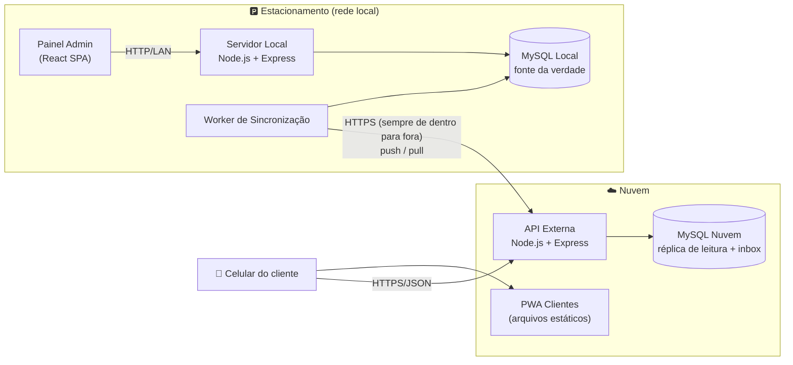
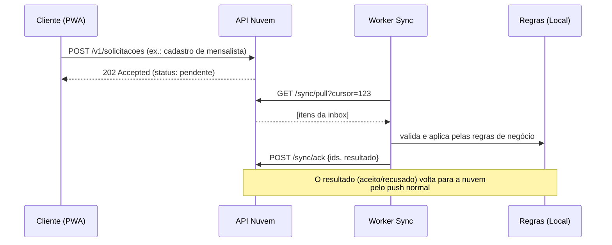

# Arquitetura Técnica — Sistema de Estacionamento

> Status: **proposta (v0.1)**. Nenhum código foi implementado ainda.
> Premissas marcadas com ⚠️ precisam de confirmação.

---

## 1. Arquitetura geral

O sistema é dividido em **dois lados**, com papéis bem separados:

- **Lado local (no estacionamento)**: é onde ficam os dados oficiais e onde acontece toda a operação. Funciona 100% sem internet.
- **Lado nuvem**: tem uma cópia parcial dos dados, só o que os clientes precisam consultar. Também recebe as poucas ações que os clientes fazem pelo celular.



### Decisões principais

| # | Decisão | Motivo |
|---|---------|--------|
| D1 | **O MySQL local é a fonte da verdade** dos dados operacionais (entradas, saídas, pagamentos, tarifas, vagas). | A operação não pode depender da internet. |
| D2 | **A nuvem só tem cópia dos dados, com uma exceção**: o que o cliente cria pelo app (cadastro, solicitações) fica numa *inbox* na nuvem até o servidor local buscar. | Cada dado tem um único lugar onde é escrito. Assim não há conflito de edição. |
| D3 | **Só o servidor local inicia a conexão**, sempre de dentro para fora. A nuvem nunca chama o servidor local. | Não é preciso abrir portas no roteador nem ter IP fixo, e o servidor local fica menos exposto. |
| D4 | A sincronização usa uma fila de eventos (**padrão Outbox**) com envio repetido seguro (**idempotente**). | Nada se perde quando a internet cai, e reenviar o mesmo evento não gera duplicidade. |
| D5 | **Monorepo** em TypeScript com um pacote `shared` de contratos (tipos e validações Zod). | O servidor local e a nuvem usam exatamente o mesmo formato de dados na sincronização. |
| D6 | A nuvem **só guarda o mínimo de dados pessoais** necessário para o cliente consultar. | LGPD e menos risco se a nuvem for invadida. |

---

## 2. Responsabilidade de cada componente

### 2.1 Painel Administrativo (`apps/admin-web`)
- Aplicação React servida pelo próprio servidor local (`http://servidor-local:8080`).
- Usada por operadores e administradores na rede do estacionamento.
- Funções: registrar entrada e saída de veículos, cobrança, caixa, mensalistas, tarifas, vagas, usuários, relatórios e o **status da sincronização** (pendências, último envio, erros).

### 2.2 Servidor Local (`apps/local-server`)
- API REST com Express usada pelo painel.
- Concentra toda a **regra de negócio**: cálculo de tarifa, permanência, caixa e mensalidades.
- Grava cada alteração **e** o evento correspondente na tabela `sync_outbox` **na mesma transação**. Assim nunca fica uma alteração sem evento, nem um evento sem alteração.
- Faz backup automático do MySQL local.

### 2.3 Worker de Sincronização (`apps/local-server/src/sync`)
- Processo separado da API, para que uma falha na sincronização não derrube a operação.
- **Push**: lê a `sync_outbox` e envia os eventos em lotes para a nuvem.
- **Pull**: busca na nuvem o que os clientes criaram (inbox) e aplica no banco local, passando pelas regras de negócio.
- Quando falha, tenta de novo com espera crescente (*backoff* exponencial) e mostra o estado no painel.

### 2.4 MySQL Local
- Schema completo: operação, financeiro, usuários, auditoria e tabelas de sincronização.
- Não fica acessível pela rede: escuta apenas em `127.0.0.1`.

### 2.5 API Externa (`apps/cloud-api`)
- **Endpoints de sincronização** (`/sync/*`): autenticados com credencial do estacionamento e assinatura HMAC.
- **Endpoints para clientes** (`/v1/*`): usados pelo PWA (consulta de vagas, tarifas, ticket, situação da mensalidade e login do cliente).
- **Não tem regra de negócio de cobrança**: só mostra o que o servidor local calculou e enviou.

### 2.6 MySQL Nuvem
- Só as tabelas que os clientes consultam (cópia), mais a `inbox` e o controle de sincronização.
- O schema é diferente do local e já vem preparado para consulta (*read model*).

### 2.7 PWA (`apps/pwa`)
- React + Vite + Service Worker, instalável no celular.
- Guarda em cache a última consulta, para abrir mesmo com sinal ruim.
- Mostra quando os dados foram atualizados pela última vez, para o cliente saber se a informação pode estar desatualizada.

---

## 3. Fluxo de comunicação entre os servidores

### 3.1 Local → Nuvem (push de eventos)

```mermaid
sequenceDiagram
  participant OP as Operador (Painel)
  participant LS as Servidor Local
  participant DB as MySQL Local
  participant W as Worker Sync
  participant API as API Nuvem
  participant CDB as MySQL Nuvem

  OP->>LS: Registrar entrada (placa ABC1D23)
  LS->>DB: BEGIN; INSERT ticket; INSERT sync_outbox; COMMIT
  LS-->>OP: 201 Created (funciona sem internet)
  loop a cada N segundos ou quando surge evento novo
    W->>DB: SELECT eventos pendentes ORDER BY seq LIMIT 100
    W->>API: POST /sync/push {lote assinado}
    API->>CDB: aplica cada evento (ignora os já recebidos)
    API-->>W: 200 {ultimo_seq_aplicado}
    W->>DB: marca até ultimo_seq como enviado
  end
```

### 3.2 Nuvem → Local (pull da inbox)



### 3.3 Quando a internet cai
1. A operação local continua normalmente e os eventos vão se acumulando na `sync_outbox`.
2. O worker tenta de novo com espera crescente: 5s → 10s → 30s → 1min → 5min, até o máximo.
3. Quando a conexão volta, ele envia os eventos pendentes em lotes, na ordem em que aconteceram.
4. O PWA continua mostrando os últimos dados, com o aviso “atualizado há X min”.

---

## 4. Tecnologias recomendadas

| Camada | Tecnologia | Observação |
|--------|-----------|------------|
| Runtime | **Node.js 22 LTS** | Mesma versão em todos os apps |
| Linguagem | **TypeScript** | Tipos compartilhados entre os apps |
| Backend | **Express 5** | Pedido no escopo |
| Validação | **Zod** | Schemas no pacote `shared` |
| Acesso ao banco | **Knex.js** + `mysql2` | Migrations e SQL explícito, sem ORM pesado |
| Banco local | **MySQL 8.4 LTS** | |
| Banco nuvem | **MySQL 8.4** gerenciado (ex.: AWS RDS, DigitalOcean, Aiven) | Mesmo motor do local, reaproveitando conhecimento e ferramentas |
| Frontend (admin e PWA) | **React 18 + Vite** | |
| PWA | **vite-plugin-pwa** (Workbox) | Cache offline e instalação no celular |
| UI | Tailwind CSS | |
| Autenticação | JWT de curta duração + *refresh token* em cookie `httpOnly` | |
| Senhas | **argon2id** | |
| Logs | **pino** | Logs em JSON |
| Processos (local) | **PM2** ou serviço do Windows/systemd | ⚠️ depende do sistema operacional do servidor local |
| Infra nuvem | Docker + VPS, ou PaaS (Render/Railway/Fly.io) | Proxy reverso com HTTPS (Caddy/Nginx) |
| Testes | Vitest + Supertest | |
| Monorepo | npm workspaces | |
| Ambiente de desenvolvimento | Docker Compose (2× MySQL) | |

---

## 5. Estrutura de pastas

```
Estacionamento/
├── apps/
│   ├── local-server/            # API local + worker de sincronização
│   │   ├── src/
│   │   │   ├── config/          # env, logger
│   │   │   ├── db/
│   │   │   │   ├── migrations/
│   │   │   │   └── seeds/
│   │   │   ├── modules/         # uma pasta por domínio
│   │   │   │   ├── auth/
│   │   │   │   ├── usuarios/
│   │   │   │   ├── veiculos/
│   │   │   │   ├── tickets/     # entrada/saída
│   │   │   │   ├── tarifas/
│   │   │   │   ├── pagamentos/
│   │   │   │   ├── caixa/
│   │   │   │   ├── mensalistas/
│   │   │   │   ├── vagas/
│   │   │   │   └── relatorios/
│   │   │   ├── sync/
│   │   │   │   ├── outbox.ts    # grava eventos na transação
│   │   │   │   ├── pusher.ts
│   │   │   │   ├── puller.ts
│   │   │   │   └── worker.ts    # processo separado
│   │   │   ├── middlewares/
│   │   │   ├── app.ts
│   │   │   └── server.ts
│   │   └── tests/
│   ├── admin-web/               # React SPA do painel
│   │   └── src/{pages,components,services,hooks}
│   ├── cloud-api/               # API externa
│   │   ├── src/
│   │   │   ├── db/migrations/
│   │   │   ├── modules/
│   │   │   │   ├── sync/        # /sync/push, /sync/pull, /sync/ack
│   │   │   │   ├── clientes/    # login/cadastro do cliente
│   │   │   │   ├── consulta/    # vagas, tarifas, ticket, mensalidade
│   │   │   │   └── solicitacoes/
│   │   │   ├── projections/     # aplica eventos no read model
│   │   │   ├── middlewares/
│   │   │   ├── app.ts
│   │   │   └── server.ts
│   │   └── tests/
│   └── pwa/                     # React + vite-plugin-pwa
│       ├── public/{icons,manifest}
│       └── src/{pages,components,services}
├── packages/
│   └── shared/                  # contratos compartilhados
│       └── src/
│           ├── events/          # tipos + Zod de cada evento de sync
│           ├── dto/
│           └── utils/           # placa, moeda, datas
├── infra/
│   ├── docker-compose.dev.yml
│   ├── cloud/                   # Dockerfile, Caddyfile
│   └── local/                   # PM2 ecosystem, scripts de backup
├── docs/
│   └── ARQUITETURA.md
├── .env.example
├── package.json                 # workspaces
└── tsconfig.base.json
```

---

## 6. Regras de comunicação e sincronização

### 6.1 Quem pode escrever cada dado (um único dono por dado)

| Dado | Dono (quem escreve) | Vai para |
|------|---------------------|----------|
| Tickets, entradas/saídas, pagamentos, caixa | Local | Nuvem (somente leitura) |
| Tarifas, vagas, configuração do estacionamento | Local | Nuvem (somente leitura) |
| Mensalistas e situação da mensalidade | Local | Nuvem (somente leitura) |
| Conta de login do cliente (e-mail/senha) | Nuvem | Não vai para o local (fica só na nuvem) |
| Solicitações do cliente (cadastro, pedido de mensalidade) | Nuvem (inbox) | Local decide → resultado volta pelo push |

Como cada dado tem um único dono, **não existem conflitos de escrita simultânea**.

### 6.2 Formato do evento

```json
{
  "event_id": "01J9Z...ULID",
  "seq": 1042,
  "type": "ticket.fechado",
  "version": 1,
  "occurred_at": "2026-11-18T14:03:22.511Z",
  "aggregate": { "type": "ticket", "id": "01J9Y..." },
  "payload": { "placa": "ABC1D23", "valor_centavos": 1800, "...": "..." }
}
```

- `event_id` (ULID): identificador **único** do evento, usado para não aplicar o mesmo evento duas vezes.
- `seq`: número sequencial **local** e crescente, que garante a ordem.
- `version`: versão do formato do evento. Mudanças que quebram compatibilidade criam uma versão nova, e a nuvem aceita as duas durante a transição.

### 6.3 Regras
1. **Atomicidade**: a alteração de negócio e o evento na `sync_outbox` são gravados na mesma transação.
2. **Ordem**: os eventos são enviados em ordem de `seq`. A nuvem rejeita um lote com buraco na sequência e informa o último `seq` recebido.
3. **Idempotência**: a nuvem registra o `event_id` numa tabela `sync_applied`. Um evento repetido é ignorado e confirmado normalmente.
4. **Lotes**: até 100 eventos ou 512 KB por requisição.
5. **Frequência**: o worker é acordado sempre que surge um evento novo, e faz também uma verificação a cada 15s. O pull da inbox acontece a cada 30s.
6. **Tentativas**: espera crescente com variação aleatória (*jitter*). Um evento que falha 10 vezes por erro de validação vai para a *dead-letter* e aparece como alerta no painel.
7. **Ressincronização completa**: o painel tem o comando “reenviar snapshot”, que reconstrói a cópia da nuvem do zero (útil na implantação ou depois de uma falha).
8. **Relógio**: os horários vêm sempre do servidor local, em UTC. A nuvem nunca usa o próprio relógio para regra de negócio.
9. **Retenção**: eventos enviados ficam 30 dias na `sync_outbox` e depois são apagados.
10. **Inbox**: cada item tem `status` (pendente → processado/rejeitado) e é confirmado com `/sync/ack`. O mesmo item processado de novo não muda nada.

### 6.4 Endpoints de sincronização (nuvem)

| Método | Rota | Função |
|--------|------|--------|
| `POST` | `/sync/push` | Recebe um lote de eventos e responde `{ last_applied_seq }` |
| `GET`  | `/sync/pull?cursor=` | Devolve os itens pendentes da inbox |
| `POST` | `/sync/ack` | Confirma os itens processados da inbox |
| `GET`  | `/sync/status` | Último `seq` recebido (para conferência e ressincronização) |
| `POST` | `/sync/snapshot` | Recebe a carga completa por partes (*chunks*) |

---

## 7. Estratégia de segurança

### 7.1 Servidor local
- API e painel acessíveis **somente na rede local**. Nenhuma porta é aberta no roteador.
- MySQL escutando só em `127.0.0.1`, com um usuário de aplicação de **privilégios mínimos** (sem `DROP` nem `GRANT`).
- Login de operadores com argon2id, bloqueio temporário após tentativas erradas e sessão com tempo de expiração.
- **Perfis de acesso (RBAC)**: `admin` (tudo), `operador` (entrada/saída/caixa), `financeiro` (relatórios). Estorno e mudança de tarifa só para `admin`.
- **Auditoria**: a tabela `audit_log` registra quem fez o quê e quando, sem poder alterar nem apagar registros pela aplicação.
- Backup diário com `mysqldump`, compactado e rotacionado (7 diários, 4 semanais). Uma cópia criptografada pode ir para a nuvem. ⚠️

### 7.2 Canal de sincronização
- Sempre **HTTPS (TLS 1.2+)**.
- Cada estacionamento tem `site_id` e um **segredo** próprio, guardado no `.env` local, que nunca vai para o Git.
- Cada requisição é assinada: `X-Signature = HMAC-SHA256(segredo, timestamp + método + rota + sha256(corpo))`, com `X-Timestamp`.
  - A nuvem recusa requisições com mais de 5 minutos de diferença de horário, o que bloqueia o reaproveitamento de requisições capturadas (*replay*).
- O segredo pode ser trocado sem parar o sistema: a nuvem aceita o atual e o anterior durante a troca.
- Os endpoints `/sync/*` ficam separados dos endpoints de cliente e têm limite de requisições próprio.

### 7.3 API externa e banco na nuvem
- `helmet`, CORS liberado **apenas** para o domínio do PWA, limite de requisições por IP e por cliente.
- Toda entrada é validada com Zod, e todo SQL usa parâmetros (*prepared statements*).
- Login do cliente com JWT de curta duração (15 min) e *refresh token* rotativo em cookie `httpOnly`, `Secure`, `SameSite=Strict`.
- O cliente só vê os **próprios** dados: toda consulta filtra pelo `cliente_id` do token, contra acesso a dados de outros clientes (IDOR).
- Banco da nuvem sem acesso público, só pela rede privada da API, com criptografia em repouso pelo provedor.
- Segredos guardados nas variáveis do provedor ou num gerenciador de segredos.

### 7.4 LGPD e dados pessoais
- A nuvem recebe **o mínimo necessário**: placa, nome e situação. CPF e documentos ficam só no local, ou vão mascarados.
- Termo de consentimento no cadastro do PWA.
- Exclusão de conta pelo cliente: apaga na nuvem e gera uma solicitação para o local.

### 7.5 PWA
- Servido só por HTTPS, com *Content-Security-Policy* restritiva.
- O cache do Service Worker guarda somente dados públicos e do próprio cliente, e é limpo no logout.

---

## 8. Pontos a confirmar ⚠️

1. **O que o cliente faz no PWA?** Proposta: ver vagas livres e tarifas, consultar o próprio ticket (tempo e valor), ver a situação da mensalidade e pedir cadastro de mensalista. Haverá **pagamento online** (Pix)? Isso muda bastante o fluxo, porque o pagamento nasceria na nuvem.
2. **É um estacionamento ou vários?** A arquitetura já prevê `site_id`, mas o modelo de dados muda se houver vários.
3. **Sistema operacional do servidor local**: Windows ou Linux? Define o PM2/serviço e os scripts de backup.
4. **Como o cliente se identifica?** E-mail e senha, código por SMS/WhatsApp, ou placa + código do ticket?
5. **Hardware**: haverá cancela, leitor de placa (LPR), impressora de ticket? Entraria como integração no servidor local.
6. **Provedor de nuvem preferido**, ou fica em aberto?
