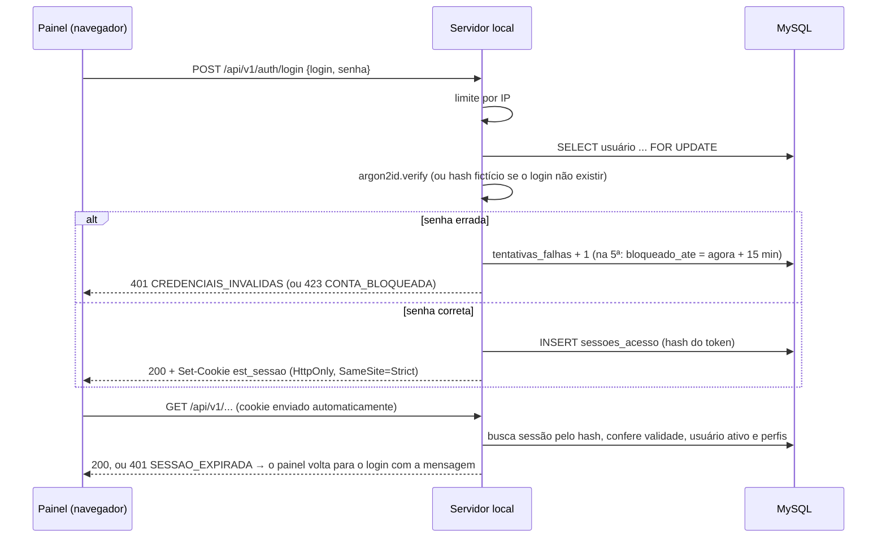

# Login e Autenticação — Painel Administrativo

> Complementa [`ARQUITETURA.md`](ARQUITETURA.md) §7.1. Código em `apps/local-server/src/modules/auth` e `apps/admin-web/src/auth`.

## 1. Decisões

| # | Decisão | Motivo |
|---|---------|--------|
| A1 | **Sessão guardada no servidor + cookie `httpOnly`**, em vez de JWT | Logout, troca de senha e desativação de usuário valem **na hora**. Num servidor local único não há vantagem em tokens sem estado, que só expiram sozinhos. |
| A2 | **Token aleatório de 256 bits.** O banco guarda só o **hash SHA-256** (`sessoes_acesso.token_hash`) | Quem obtiver uma cópia do banco não consegue usar as sessões. |
| A3 | **Senhas com argon2id** (m=19 MiB, t=2, p=1, parâmetros da OWASP), via `@node-rs/argon2` | Algoritmo recomendado hoje. A biblioteca já traz binários prontos para Windows, então não é preciso compilador. |
| A4 | **Bloqueio por conta** (5 erros → 15 min) **e limite por computador** (20 falhas / 15 min por IP) | O primeiro protege uma conta; o segundo impede testar senhas em muitos logins a partir de um mesmo PC. |
| A5 | **Mensagem genérica** “Usuário ou senha inválidos” para login inexistente, senha errada e usuário inativo, **com o mesmo tempo de resposta** | Não revela quais logins existem. |
| A6 | **Todas as rotas da API exigem login por padrão.** Um módulo só é público se for marcado `publico: true` | Um módulo novo nunca nasce aberto por esquecimento. |
| A7 | **Permissões verificadas no servidor** (`exigirPermissao`). O painel só esconde menus | O que protege os dados é o servidor; esconder menu não é segurança. |

## 2. Fluxo



## 3. Regras de sessão

| Regra | Padrão | Variável no `.env` |
|-------|--------|---------------------|
| Expira após ficar sem uso | 60 min | `SESSAO_INATIVIDADE_MIN` |
| Duração máxima (um turno) | 12 h | `SESSAO_DURACAO_MAX_HORAS` |
| Senhas erradas até bloquear a conta | 5 | `LOGIN_MAX_TENTATIVAS` |
| Tempo de bloqueio | 15 min | `LOGIN_BLOQUEIO_MIN` |
| Falhas por IP a cada 15 min | 20 | `LOGIN_LIMITE_POR_IP` |
| Cookie só por HTTPS | não | `COOKIE_SECURE` |

- **Logout:** encerra a sessão no banco e apaga o cookie.
- **Troca de senha:** encerra **as outras** sessões do usuário; a atual continua.
- **Usuário desativado ou sem perfil no estacionamento:** a próxima requisição dele recebe 401.
- **Troca de senha obrigatória** (`deve_trocar_senha`): o usuário consegue entrar, mas qualquer rota fora de `/auth` responde **403 `TROCA_SENHA_OBRIGATORIA`** até ele trocar a senha.
- **Sessões vencidas:** uma rotina a cada 10 min as marca como encerradas. As linhas ficam guardadas como histórico de acesso.

## 4. Proteções adicionais

- **CSRF:**
  - cookie `SameSite=Strict`;
  - a API só aceita JSON;
  - `POST/PUT/DELETE` vindos de navegador precisam ter `Origin` igual ao do servidor (ou estar em `CORS_ORIGINS`).
- **Cabeçalhos HTTP:** `helmet` (CSP, `X-Frame-Options`, `nosniff`...). `upgrade-insecure-requests` e HSTS só são ligados com `COOKIE_SECURE=true`, porque em HTTP na rede local eles impediriam outros PCs de carregar o painel.
- **Histórico:**
  - `auth.login`, `auth.login_falhou` (com motivo e IP), `auth.login_recusado_bloqueio` e `auth.logout` são registrados pela aplicação;
  - `usuario.bloqueado` e `usuario.senha_alterada` são registrados pelos triggers.
- **Concorrência:** a linha do usuário é travada (`FOR UPDATE`) durante o login, para que tentativas simultâneas sejam contadas corretamente.

## 5. API

| Método | Rota | Acesso | Resposta |
|--------|------|--------|----------|
| POST | `/api/v1/auth/login` | público | `200` sessão + cookie · `400` · `401 CREDENCIAIS_INVALIDAS` · `403 SEM_PERMISSAO` · `423 CONTA_BLOQUEADA` · `429 MUITAS_TENTATIVAS` |
| POST | `/api/v1/auth/logout` | qualquer | `204` (sempre apaga o cookie) |
| GET | `/api/v1/auth/sessao` | logado | `200` usuário, perfis, permissões e validade · `401` |
| POST | `/api/v1/auth/trocar-senha` | logado | `204` · `400` senha fraca · `422` senha atual incorreta |

## 6. Níveis de acesso e permissões

Três níveis (migrations `006` e `016`):

| Nível | Permissões |
|-------|-----------|
| **Administrador** (proprietário) | **Todas**, calculadas na hora a partir do catálogo, inclusive as que forem criadas no futuro |
| **Gerente** | As marcadas individualmente, **menos** as exclusivas do Administrador: `backup.gerenciar`, `config.seguranca`, `perfil.gerenciar` e `usuario.sessoes` |
| **Operador** (código `funcionario`) | As marcadas individualmente, **menos** as do Administrador e as de supervisão: tarifas (alterar/publicar), relatório financeiro, funcionários e usuários, configurações, supervisão de caixa, estorno, cancelamento, auditoria, LGPD, monitoramento e reenvio da sincronização |

- **O nível é o teto**, conferido no servidor a cada requisição (`permissaoCabeNoNivel`, em `packages/shared/src/usuarios.ts`). Uma permissão acima do nível não vale, nem se for gravada direto no banco. O cadastro recusa (400) permissões que não cabem no nível.
- **Gerente** cadastra e ajusta só Operadores. Criar Gerentes e Administradores é do Administrador.
- **Permissões padrão por nível:** os modelos **Padrão do Gerente** e **Padrão do Operador** vêm marcados ao escolher o nível no cadastro. O Administrador muda em Configurações → Usuários e permissões (`PUT /api/v1/permissoes/modelos/:codigo`).
- **Limite de desconto:** Gerente e Operador concedem desconto na saída só até o limite definido pelo Administrador (percentual do valor e/ou valor em reais; vale o menor). Acima disso, a API responde **403 `LIMITE_AJUSTE`** com o máximo permitido. Padrão: Gerente 50%, Operador 0%.
- **Migração sem perda de acesso:** na atualização, funcionários que já tinham alguma permissão de supervisão viraram Gerente.
- **Tentativas de acesso sem permissão** (403) ficam no histórico como `acesso.negado`, uma vez por usuário e rota a cada 10 minutos.

### Regras de sessão e senha pelo painel

Configurações → Segurança e acessos (só Administrador) define: tempo sem uso, duração máxima da sessão, tentativas até bloquear, tempo de bloqueio, tamanho mínimo da senha, exigir maiúscula, exigir símbolo e **acesso só pela rede local** (recusa login vindo de IP público, `403 ACESSO_RESTRITO`). Enquanto nada for salvo, valem os valores do `.env`. A mesma aba lista as **sessões abertas** e permite encerrar a de outro usuário.

- Os perfis antigos **Operador de caixa** e **Financeiro** viraram **modelos** (`perfis.uso = MODELO`). Eles preenchem os checkboxes com um clique e não podem ser atribuídos diretamente (o banco recusa).
- **Mudanças de permissão valem na hora:** as permissões são lidas a cada requisição, então as sessões abertas já seguem as novas regras.
- **Proteções contra escalada de privilégio:**
  - ninguém altera o próprio nível nem as próprias permissões, e ninguém desativa o próprio usuário;
  - só um Administrador concede o nível Administrador ou mexe em dados e acesso de outro Administrador;
  - quem não é Administrador só concede permissões que ele mesmo possui;
  - o sistema nunca fica sem um Administrador ativo.

Uso no código:

- **No servidor**, em qualquer rota:
  ```ts
  router.post('/', exigirPermissao('tarifa.publicar'), handler);           // exige esta permissão
  router.get('/', exigirPermissao('caixa.operar', 'caixa.supervisionar'), handler); // basta UMA delas
  ```
- **No painel:**
  - `useAuth().temPermissao('...')` decide o que mostrar;
  - `<RotaProtegida permissoes={[...]}>` protege uma tela;
  - o menu (`components/Layout.tsx`) declara as permissões de cada item.
- **Permissão nova:** entra por migration (`INSERT` em `permissoes`) e aparece sozinha na tela de permissões.

## 6.1 Gerenciamento de usuários (API)

| Método | Rota | Permissão |
|--------|------|-----------|
| GET | `/api/v1/usuarios?busca=&situacao=ativos\|inativos\|todos&nivel=` | `usuario.gerenciar` ou `funcionario.gerenciar` |
| GET | `/api/v1/usuarios/:id` | idem |
| POST | `/api/v1/usuarios` (dados + `acesso` opcional) | `funcionario.gerenciar` (+ `usuario.gerenciar` se criar acesso) |
| PATCH | `/api/v1/usuarios/:id` (dados pessoais) | `funcionario.gerenciar` |
| PUT | `/api/v1/usuarios/:id/acesso` (login, nível, permissões) | `usuario.gerenciar` |
| POST | `/api/v1/usuarios/:id/desativar` · `/reativar` (`motivo` obrigatório) | `funcionario.gerenciar` (+ `usuario.gerenciar` se tiver acesso) |
| POST | `/api/v1/usuarios/:id/redefinir-senha` · `/desbloquear` | `usuario.gerenciar` |
| GET | `/api/v1/permissoes` (catálogo por módulo + modelos) | `usuario.gerenciar` ou `funcionario.gerenciar` |
| GET | `/api/v1/atividades?modulo=&usuarioId=&de=&ate=&antesDe=` | `auditoria.ver` |

Regras de cadastro:
- **Funcionários e usuários nunca são excluídos** (o banco bloqueia), porque aparecem no histórico. Use **Desativar**: o acesso é bloqueado e as sessões abertas são encerradas na hora.
- Um funcionário pode existir **sem acesso ao sistema** (ex.: manobrista).
- Ao criar o acesso ou redefinir a senha, o administrador define uma **senha provisória**, e o funcionário troca no primeiro login.

## 6.2 Histórico de atividades

**Registrado pelo banco (triggers),** com quem fez, quando, os dados antes e depois, e o motivo:
- entrada e saída de veículos, cancelamento e alteração de ticket;
- tarifas publicadas, arquivadas e excluídas;
- pagamentos e estornos, abertura e fechamento de caixa;
- vagas;
- **exclusões** de vagas, categorias, clientes, veículos e postos;
- funcionários cadastrados, alterados, desativados e reativados;
- usuários criados ou alterados, níveis e permissões concedidos ou removidos, senhas, bloqueios, configurações.

**Registrado pela aplicação:** login, logout, falhas de login, senha redefinida pelo administrador e desbloqueio.

**No painel:** menu *Atividades*, com filtros por tipo, usuário e período, e paginação. A tela de cada funcionário tem o atalho *Ver atividades deste usuário*.

## 7. Primeiro acesso

```bash
npm run db:migrar
```

```bash
npm run usuario:admin
```

Ou, no Windows, dê dois cliques em `Criar-Administrador.cmd`. O comando pergunta o nome do estacionamento (só na primeira vez), o nome, o login e a senha do administrador. A senha não aparece enquanto é digitada.

**Desbloquear uma conta antes do prazo:** menu *Funcionários* → abra o funcionário → **Desbloquear conta**.
