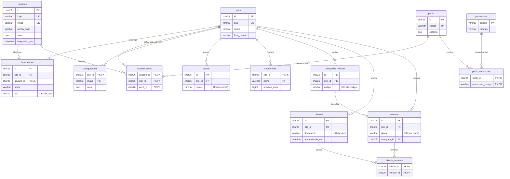
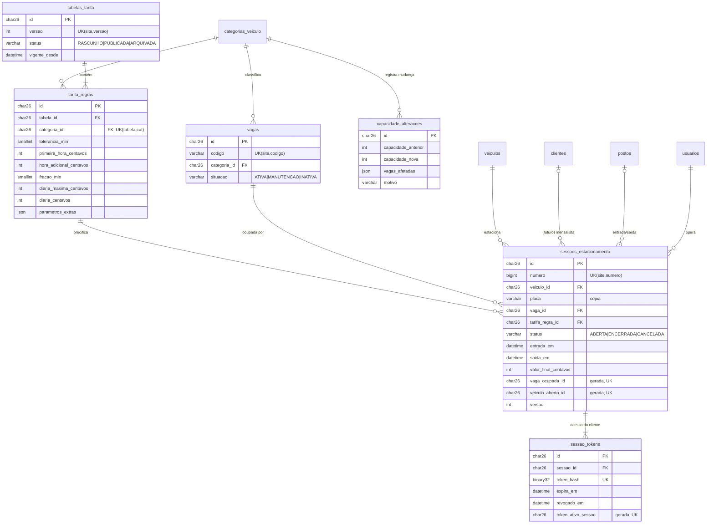
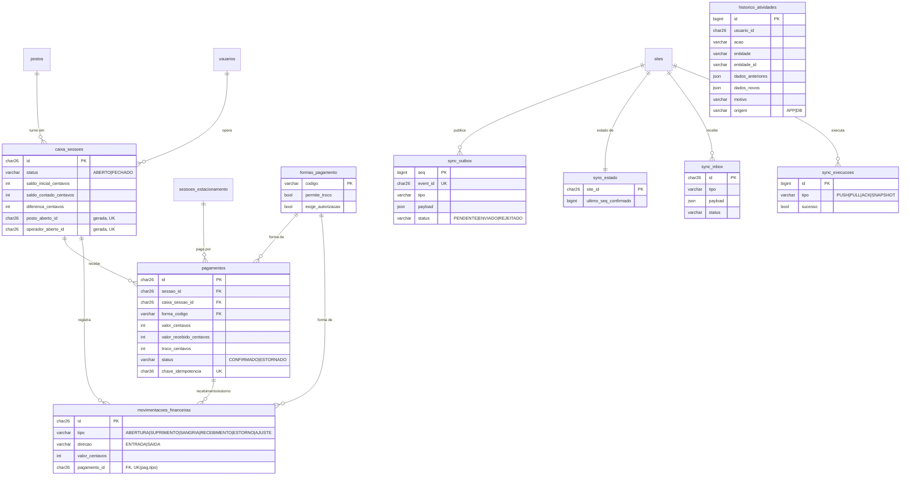

# Banco de Dados Local — Modelo Completo (MySQL 8.4)

> Complementa [`ARQUITETURA.md`](ARQUITETURA.md). Os scripts estão em [`database/local/`](../database/local) e foram **validados no MySQL 8.4** com 72 testes de integridade ([`tests/run_tests.sh`](../database/local/tests/run_tests.sh)).

| Script | Conteúdo |
|--------|----------|
| `001_schema.sql` | 29 tabelas, chaves, CHECKs e índices |
| `002_triggers.sql` | 39 triggers: regras de integridade e histórico automático |
| `003_views.sql` | 6 views: ocupação, mapa de vagas, sessões abertas, caixa, tarifa vigente, sincronização |
| `004_seed.sql` | Formas de pagamento, permissões e perfis padrão. Pode ser executado de novo sem duplicar nada |
| `007_vagas.sql` | Registro do bloqueio manual (motivo, quando, quem), formato do código da vaga, proteção de categorias com vagas e histórico de capacidade |
| `006_usuarios_permissoes.sql` | Níveis Administrador/Funcionário, permissões individuais (`usuario_permissoes`), modelos de permissão, e triggers de histórico para entradas, exclusões, funcionários e permissões |
| `005_autenticacao.sql` | Tabela `sessoes_acesso` (sessões de login; ver [`AUTENTICACAO.md`](AUTENTICACAO.md)) e a permissão `usuario.sessoes` |

As migrations aplicadas ficam registradas na tabela `schema_migracoes`, criada e mantida por `npm run db:migrar`.

---

## 1. Decisões de modelagem

| # | Decisão | Motivo |
|---|---------|--------|
| M1 | **Chave primária ULID** (`CHAR(26)` em `ascii_bin`), gerada pela aplicação | Única entre servidor local e nuvem (necessário para sincronizar e ter vários estabelecimentos), ordenada pelo tempo (inserção eficiente no InnoDB) e legível nos logs. |
| M2 | **`site_id` nas tabelas operacionais** | Vários estabelecimentos sem refazer o banco. Usuários, perfis e catálogos são globais, e o acesso de cada usuário é definido por site (`usuario_perfis`). |
| M3 | **`DATETIME(3)` sempre em UTC** | `TIMESTAMP` acaba em 2038. A conexão usa `time_zone = '+00:00'`, e a conversão para `America/Sao_Paulo` acontece só na exibição e no cálculo da tarifa. |
| M4 | **Dinheiro em `INT UNSIGNED` de centavos** | Sem erro de arredondamento. |
| M5 | **Estados em `VARCHAR` + `CHECK`; catálogos em tabelas** | Estados quase não mudam. Formas de pagamento, permissões e categorias crescem com um `INSERT`, sem `ALTER TABLE`. Não se usa `ENUM`. |
| M6 | **Nada referenciado é apagado** | As FKs usam `RESTRICT`. Cadastros são desativados (`ativo`/`desativado_em`), sessões são canceladas, pagamentos são estornados. |
| M7 | **Pagamentos, movimentações e histórico só aceitam inserção** | Garantido por trigger. Corrigir um valor é sempre um novo registro (estorno ou ajuste), nunca a edição do antigo. |
| M8 | **Tarifas versionadas e imutáveis depois de publicadas** | Cada sessão aponta para a regra vigente na entrada, então o valor é sempre reproduzível. |
| M9 | **Unicidade condicional com colunas geradas** | Ex.: `vaga_ocupada_id = IF(status='ABERTA', vaga_id, NULL)` com índice `UNIQUE`. Como o MySQL aceita vários `NULL` num índice único, isso bloqueia duas sessões abertas na mesma vaga sem impedir o histórico. |
| M10 | **Regras críticas no banco e também na aplicação** | A API valida antes e dá mensagens amigáveis. O banco é a última barreira, inclusive contra SQL manual. |

---

## 2. Diagrama entidade-relacionamento

O modelo está dividido em três diagramas para facilitar a leitura. Uma entidade que aparece em mais de um diagrama é a mesma tabela.

### 2.1 Acesso, estabelecimento e cadastros



### 2.2 Operação: vagas, tarifas e sessões



### 2.3 Financeiro, auditoria e sincronização



`historico_atividades` **não tem FKs de propósito**: o registro de auditoria precisa continuar existindo mesmo que cadastros mudem.

---

## 3. Tabelas por entidade solicitada

| Entidade | Tabela(s) | Observações |
|----------|-----------|-------------|
| Usuários | `usuarios` | Só a credencial: login, hash argon2id, bloqueio por tentativas, troca obrigatória de senha. |
| Funcionários | `funcionarios` | Dados da pessoa (nome, CPF, cargo, admissão). Ligação **0..1** com `usuarios`: um funcionário pode não ter acesso ao sistema. |
| Permissões | `permissoes`, `perfis`, `perfil_permissoes`, `usuario_perfis` | RBAC: permissão → perfil → usuário **por site**. Perfis padrão: `admin`, `operador`, `financeiro`. |
| Vagas | `vagas`, `categorias_veiculo`, `capacidade_alteracoes` | Uma linha por vaga física (ver §5). |
| Veículos | `veiculos` | Placa normalizada (maiúsculas, sem hífen), padrão antigo e Mercosul, com opção de placa estrangeira. |
| Clientes | `clientes`, `cliente_veiculos` | **Opcional na v1** (cliente avulso não precisa de cadastro). Base para mensalistas. Relação N:N com veículos. |
| Sessões de estacionamento | `sessoes_estacionamento`, `sessao_tokens` | O ticket. Guarda **cópia** da placa e a regra de tarifa usada. O token do QR fica numa tabela separada, para manter o histórico de revogações. |
| Tarifas | `tabelas_tarifa`, `tarifa_regras` | Versão → uma regra por categoria. Os campos de pernoite já existem (desligados). |
| Pagamentos | `pagamentos`, `formas_pagamento` | Vários por sessão (pagamento dividido). Troco validado. Os campos `origem = ONLINE` e `caixa_sessao_id` nulo já preparam o Pix online. |
| Movimentações financeiras | `movimentacoes_financeiras`, `caixa_sessoes` | Livro-caixa só de inserção, dentro de um turno de caixa por operador e posto. |
| Histórico de atividades | `historico_atividades` | Auditoria com dados antes e depois em JSON. |
| Registros de sincronização | `sync_outbox`, `sync_estado`, `sync_inbox`, `sync_execucoes` | Outbox (§6 da arquitetura), estado confirmado, inbox futura e registro de cada execução. |
| *(apoio)* | `sites`, `configuracoes`, `postos`, `sequencias` | Estabelecimento, parâmetros (retenção, prazos), estações de trabalho e numeração legível do ticket. |

As definições completas de colunas, tipos e comentários estão em [`001_schema.sql`](../database/local/001_schema.sql).

---

## 4. Integridade e regras contra duplicidade

### 4.1 Unicidade

| Regra | Como é garantida |
|-------|------------------|
| Login e e-mail de usuário únicos | `uq_usuarios_login`, `uq_usuarios_email` |
| CPF de funcionário único por site; um usuário para um só funcionário | `uq_funcionarios_cpf`, `uq_funcionarios_usuario` |
| Documento de cliente único por site | `uq_clientes_documento` |
| **Placa única por site** | `uq_veiculos_placa` + placa normalizada + `CHECK` de formato |
| Código de vaga único por site | `uq_vagas_codigo` |
| **Vaga com no máximo 1 sessão aberta** | coluna gerada `vaga_ocupada_id` + `UNIQUE` |
| **Veículo com no máximo 1 sessão aberta** | coluna gerada `veiculo_aberto_id` + `UNIQUE` |
| Número do ticket único por site | `uq_sessoes_numero` (gerado pela tabela `sequencias` com `FOR UPDATE`) |
| Token único; **1 token ativo por sessão** | `uq_tokens_hash`, coluna gerada `token_ativo_sessao` + `UNIQUE` |
| Uma versão por número; uma regra por categoria na versão | `uq_tabelas_versao`, `uq_regras_categoria` |
| **1 caixa aberto por posto e por operador** | colunas geradas `posto_aberto_id`, `operador_aberto_id` + `UNIQUE` |
| **Pagamento não duplica com duplo clique ou reenvio** | `chave_idempotencia` (UUID gerado pela tela) `UNIQUE`. Um reenvio devolve o pagamento já gravado |
| Um recebimento e no máximo um estorno por pagamento | `uq_mov_pagamento_tipo (pagamento_id, tipo)` |
| Evento de sincronização único | `uq_outbox_event`. Na inbox, a chave primária é o ID gerado na nuvem |

### 4.2 Restrições de domínio (CHECK)
- Formatos: placa, CPF/CNPJ, login, slug, códigos de catálogo.
- Consistência de estado:
  - `ABERTA` ⇒ sem saída e sem valor final.
  - `ENCERRADA` ⇒ saída, operador de saída e valores preenchidos.
  - `CANCELADA` ⇒ quem cancelou, quando e o motivo.
- Contas:
  - `valor_final = calculado − desconto + acréscimo`.
  - Desconto ou acréscimo exige motivo.
  - `troco = recebido − valor`, com `recebido ≥ valor`.
  - Diferença de caixa = `contado − esperado`.
- Datas: saída ≥ entrada; fechamento ≥ abertura; desligamento ≥ admissão.
- Movimentações: o tipo determina a direção (sangria é sempre `SAIDA`, recebimento sempre `ENTRADA` e ligado a um pagamento).
- Tarifas: fração completa ou ausente (1–59 min), pernoite com todos os campos ou nenhum, diária máxima ≥ 1ª hora, tolerância ≤ 240 min.

### 4.3 Regras garantidas por trigger

| Regra | Tabela |
|-------|--------|
| Não entra veículo em vaga em manutenção ou inativa | `sessoes_estacionamento` |
| Sessão só usa regra de tabela **publicada** | `sessoes_estacionamento` |
| **Só encerra se a soma dos pagamentos for igual ao valor final** | `sessoes_estacionamento` |
| Sessão encerrada ou cancelada é imutável; nunca é excluída | `sessoes_estacionamento` |
| Não inativa nem muda a categoria de vaga ocupada | `vagas` |
| Tabela publicada é imutável (só pode ser arquivada); não publica sem regras | `tabelas_tarifa`, `tarifa_regras` |
| Pagamento só em sessão aberta e com caixa aberto; troco só em forma que aceita troco | `pagamentos` |
| Pagamento só muda de `CONFIRMADO` para `ESTORNADO`; nunca é excluído | `pagamentos` |
| Caixa fechado é imutável e não recebe movimentações | `caixa_sessoes`, `movimentacoes_financeiras` |
| Token revogado não pode ser reativado | `sessao_tokens` |
| Movimentações, histórico de capacidade e auditoria só aceitam inserção | várias |

---

## 5. Capacidade alterável pelo administrador

- **Capacidade é derivada, não digitada.** Ela é calculada a partir das vagas cadastradas:
  - capacidade total = vagas `ATIVA` + `MANUTENCAO`;
  - livres = vagas `ATIVA` sem sessão aberta (view `vw_ocupacao_categoria`).
- **Aumentar** a capacidade cria vagas novas (ou reativa vagas `INATIVA`).
- **Reduzir** marca vagas como `INATIVA`, que nunca são apagadas, porque o histórico de sessões aponta para elas. O banco **impede inativar vaga ocupada**.
- **Manutenção** tira a vaga temporariamente da disponibilidade sem mudar a capacidade.
- Cada alteração feita pela tela “Alterar capacidade” grava, **na mesma transação**:
  1. a mudança nas vagas;
  2. uma linha em `capacidade_alteracoes` (antes, depois, vagas afetadas, motivo, quem fez);
  3. o evento `vagas.disponibilidade` na `sync_outbox`.

---

## 6. Histórico de alterações importantes

São três níveis complementares:

1. **Histórico genérico automático** (`historico_atividades`, `origem = 'DB'`). Os triggers gravam dados antes e depois em JSON. Ações registradas:
   - `vaga.criada`, `vaga.alterada`
   - `tarifa.publicada` (com todas as regras), `tarifa.arquivada`
   - `sessao.alterada` (placa, vaga, categoria, horário de entrada, desconto), `sessao.encerrada`, `sessao.cancelada`, `sessao.anonimizada`
   - `ticket.token_revogado`
   - `pagamento.registrado`, `pagamento.estornado`
   - `caixa.aberto`, `caixa.fechado`
   - `usuario.alterado`, `usuario.senha_alterada` (sem gravar o hash), `usuario.bloqueado`
   - `usuario.perfil_concedido`, `usuario.perfil_removido`
   - `perfil.permissao_concedida`, `perfil.permissao_removida`
   - `config.criada`, `config.alterada`
2. **Eventos registrados pela aplicação** (`origem = 'APP'`), para ações que não alteram dados: login, falha de login, QR mostrado ou reenviado, relatório exportado, snapshot solicitado.
3. **Histórico próprio de cada domínio**:
   - `tabelas_tarifa`: as versões ficam todas guardadas.
   - `capacidade_alteracoes`.
   - `sessao_tokens`: revogações.
   - `pagamentos`: estornos preservam o original.
   - `movimentacoes_financeiras`: livro-caixa.

**Quem fez e por quê:** antes de cada transação, a aplicação define `@app_usuario_id`, `@app_motivo`, `@app_posto_id` e `@app_correlacao_id`. Os triggers leem essas variáveis. A conexão é devolvida ao pool com elas limpas.

**Controle de concorrência:** a coluna `sessoes_estacionamento.versao` é incrementada pelo trigger a cada alteração. A API usa `UPDATE ... WHERE id = ? AND versao = ?`. Se dois operadores editarem o mesmo ticket ao mesmo tempo, o segundo recebe “registro alterado por outro usuário” em vez de sobrescrever o primeiro.

---

## 7. Índices

Além das chaves primárias e únicas, os índices foram escolhidos pelas consultas mais frequentes:

| Consulta | Índice |
|----------|--------|
| Sessões abertas / painel do dia | `ix_sessoes_status_entrada (site_id, status, entrada_em)` |
| Buscar ticket pela placa | `ix_sessoes_placa (placa, entrada_em)`, `uq_veiculos_placa` |
| Histórico de um veículo | `ix_sessoes_veiculo (veiculo_id, entrada_em)` |
| Relatório de saídas e faturamento | `ix_sessoes_saida`, `ix_pagamentos_data`, `ix_pagamentos_forma` |
| Disponibilidade por categoria | `ix_vagas_disponibilidade (site_id, categoria_id, situacao)` + `uq_sessoes_vaga_aberta` |
| Fechamento de caixa | `ix_mov_caixa (caixa_sessao_id, tipo)`, `ix_pagamentos_caixa` |
| Tarifa vigente | `ix_tabelas_vigencia (site_id, status, vigente_desde)` |
| Worker: próximos eventos | `ix_outbox_pendentes (status, seq)` |
| Limpeza da outbox | `ix_outbox_limpeza (status, enviado_em)` |
| Auditoria por registro, usuário, ação ou período | `ix_hist_entidade`, `ix_hist_usuario`, `ix_hist_acao`, `ix_hist_data` |

Todas as FKs têm índice (o InnoDB exige, e isso evita bloqueios em cascata).

---

## 8. Expansão sem reconstruir o banco

| Futuro | O que já está pronto | O que será preciso |
|--------|---------------------|--------------------|
| Vários estacionamentos | `site_id`, acesso por site, `sequencias` por site | Nada estrutural |
| Mensalistas | `clientes`, `cliente_veiculos`, `sessoes.cliente_id`, `sync_inbox` | Nova tabela `mensalidades` (migração aditiva) |
| Pix online | `pagamentos.origem = 'ONLINE'`, `caixa_sessao_id` opcional, `sync_inbox` | `INSERT` em `formas_pagamento` (`PIX_ONLINE`) |
| Pernoite e regras novas | Colunas `pernoite_*` + `parametros_extras JSON` | Só mudança na função de cálculo |
| Nova categoria (van, caminhão) | `categorias_veiculo` | `INSERT` |
| Nova permissão | `permissoes` | `INSERT` |
| LPR, sensores, cancela, impressora | `origem_entrada` (`LPR`, `SENSOR`), `vaga_id` opcional, `postos` | Nova tabela `dispositivos` (migração aditiva) |

**Regra de evolução:** toda mudança no banco é uma **migration versionada e aditiva** (nova tabela ou coluna anulável), num novo arquivo `database/local/NNN_descricao.sql`, aplicado em ordem pelo runner do servidor local (`apps/local-server/src/db/scripts-sql.ts`). Os scripts `001`–`004` são a **versão inicial**. O controle de quais migrations já foram aplicadas num banco existente entra junto com a primeira migration nova. Remover ou renomear coluna só acontece em duas etapas (*expand/contract*): primeiro a aplicação para de usar a coluna, depois a coluna é removida numa versão posterior.

---

## 9. Como executar

```bash
# Funciona no PowerShell, no Prompt de Comando e no Linux (cliente mysql no PATH).
# Execute a partir da pasta raiz do projeto:
mysql -uroot -p -e "CREATE DATABASE estacionamento CHARACTER SET utf8mb4 COLLATE utf8mb4_0900_ai_ci;"
mysql -uroot -p estacionamento -e "source database/local/001_schema.sql"
mysql -uroot -p estacionamento -e "source database/local/002_triggers.sql"
mysql -uroot -p estacionamento -e "source database/local/003_views.sql"
mysql -uroot -p estacionamento -e "source database/local/004_seed.sql"
```

> Não use `mysql ... < arquivo.sql` no PowerShell: o PowerShell não aceita `<` para redirecionar entrada.
>
> Alternativa visual: no **MySQL Workbench**, abra cada arquivo em *File → Open SQL Script* e execute-os em ordem (001 → 004) com o banco `estacionamento` selecionado. O Workbench entende o `DELIMITER` dos triggers.

Ou, com o projeto Node instalado (`npm install`), um único comando que cria o banco e aplica as migrations pendentes (pode ser repetido; só aplica o que falta):

```bash
npm run db:migrar
```

Testes de integridade (criam e apagam o banco `est_test`):

```bash
MYSQL="mysql -uroot -psenha" ./database/local/tests/run_tests.sh
```

Configuração recomendada no `my.ini` do servidor Windows:

```ini
[mysqld]
bind-address          = 127.0.0.1
default-time-zone     = '+00:00'
character-set-server  = utf8mb4
collation-server      = utf8mb4_0900_ai_ci
log_bin_trust_function_creators = 1   ; necessário para criar triggers com usuário não-root
```

**Usuário da aplicação**, com privilégio mínimo:
- Recebe `SELECT, INSERT, UPDATE, DELETE, EXECUTE` no banco.
- Não recebe `DROP`, `ALTER` nem `GRANT`.
- As migrations rodam com um usuário separado.
